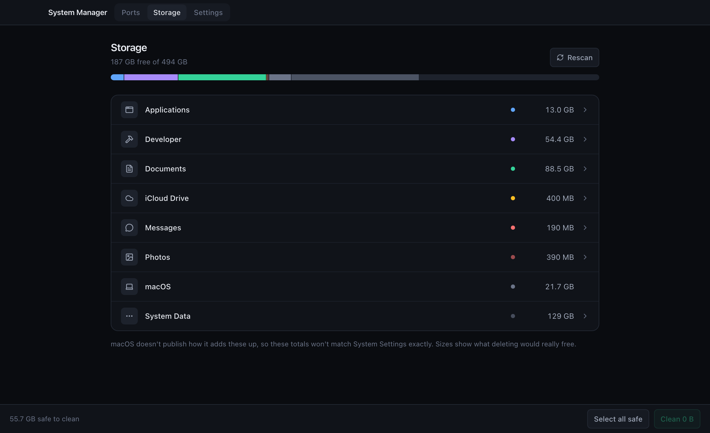
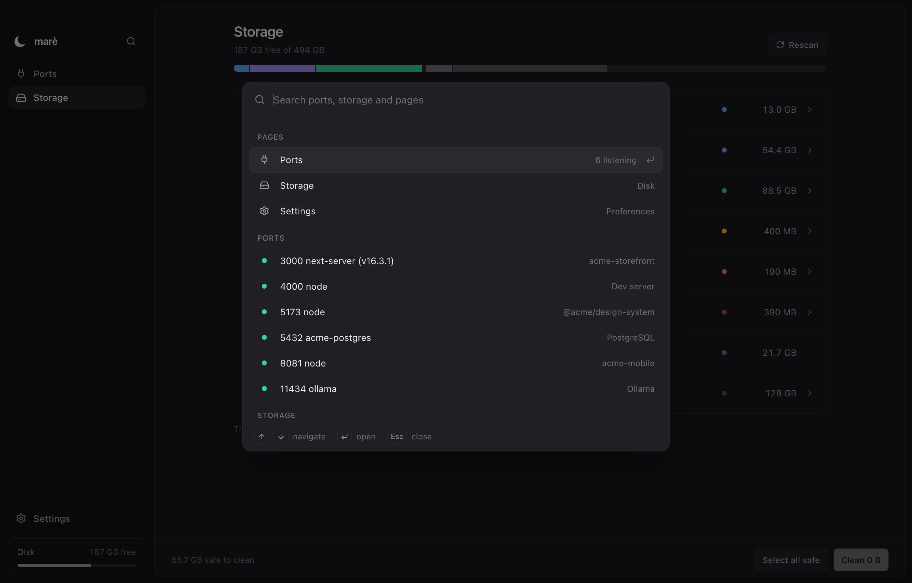
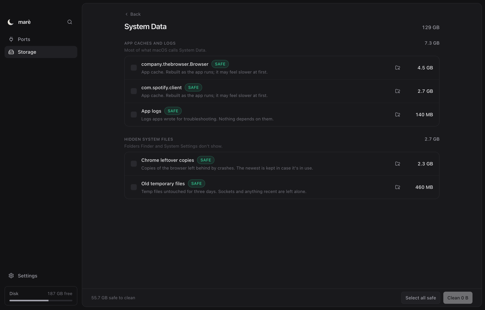

<div align="center">


# marè

**See what's using your Mac's ports and disk, and clear space without breaking anything.**

[Install](#install) · [Ports](#ports) · [Storage](#storage) · [Privacy](#privacy-and-permissions) · [Development](docs/development.md)

</div>



System Settings shows how much space System Data takes, but not what's in it, and
offers no way to remove any of it. marè breaks it down into the caches,
package stores and leftover files behind it, shows what deleting each one would really
free, and clears the ones that rebuild themselves.

It also lists every listening port on your Mac with the project folder behind it, so
"what's on 5173 and can I stop it?" takes one glance instead of three commands. Press
⌘K from anywhere to jump to a port, a storage category or a page.



## Install

marè runs on macOS 10.15 or later, on Apple Silicon and Intel.

### With the install script

```bash
curl -fsSL https://raw.githubusercontent.com/heisdeku/mare/main/scripts/install.sh | bash
```

The script downloads the latest release, checks its SHA-256 checksum against the one
published with it, and installs the app to `/Applications`. Run it again to update.

To install a specific version, or to remove the app:

```bash
curl -fsSL https://raw.githubusercontent.com/heisdeku/mare/main/scripts/install.sh | bash -s -- --version 0.1.0
```

```bash
curl -fsSL https://raw.githubusercontent.com/heisdeku/mare/main/scripts/install.sh | bash -s -- --uninstall
```

### With Homebrew

```bash
brew tap heisdeku/tap
```

```bash
brew trust --tap heisdeku/tap
```

```bash
brew install --cask mare
```

Homebrew asks you to trust a tap before it installs from one that isn't official.

### From the disk image

Download the `.dmg` from the [latest release](https://github.com/heisdeku/mare/releases/latest)
and drag marè into Applications.

marè isn't notarised by Apple yet, so the first time you open a copy
downloaded in a browser, macOS says it can't check the app for malware. To open it:

1. Open marè once and close the warning.
2. Open System Settings › Privacy & Security.
3. Under Security, click Open Anyway next to marè, then confirm.

Or remove the download flag in Terminal, which has the same effect:

```bash
xattr -dr com.apple.quarantine "/Applications/marè.app"
```

The install script and Homebrew do this for you, so their installs open without a
warning.

## Ports


Every listening port on the Mac, with the process behind it and the project it runs from.

- Each row shows the process name, command line, PID, CPU and memory. IPv4 and IPv6
  bindings of the same port share one row.
- The folder comes from the process's working directory, walked up to the nearest
  `package.json`, `Cargo.toml`, `go.mod` or similar. Open it in Finder, Terminal or
  your editor.
- A dev server whose worktree was deleted still holds its port. Its folder is marked
  Deleted.
- Docker ports show the container and image instead of `com.docker.backend`.
- Each port says whether only this Mac can reach it, or your whole network.

Pause and stop send real signals to the process:

| Action | Signal | What happens |
| --- | --- | --- |
| Pause | `SIGSTOP` | The process freezes but keeps its port, so nothing else can take it. |
| Resume | `SIGCONT` | It carries on from where it stopped. |
| Stop | `SIGTERM` | It shuts down and releases the port. |
| Force stop | `SIGKILL` | Offered only after a process ignores Stop. |

Pause a dev server you aren't using right now. It stops using CPU and keeps its port
until you resume it.

marè won't signal macOS's own critical processes, processes run by other
users, or itself. It also checks that the PID still belongs to the process you picked,
so a recycled PID is never hit.

## Storage



Storage uses the same categories as System Settings. Open one to see what's inside,
and open your own folders as far down as you need.

| Category | What you can do |
| --- | --- |
| Developer, System Data | Delete. These rebuild themselves, so they skip the Trash. |
| Applications, Documents, iCloud Drive | Move to the Trash, where Put Back works. The space returns when you empty the Trash. |
| Messages, Photos | View only, with a button to open the app. Removing files from inside their libraries corrupts them. |
| macOS | View only. |

Sizes show what deleting would free, which is often much less than Finder or `du`
reports. APFS lets files share disk blocks, and a shared block only comes back once
nothing uses it. On one Mac, Chrome had left 69 copies of itself behind after crashes.
`du` counted them as 118 GB; deleting them all freed 2.3 GB, and that's the number
marè shows.

Each item is marked:

| Mark | Meaning |
| --- | --- |
| Safe | Rebuilds itself. The cost is a slower next launch or install. |
| Review | Check it first. You may not be able to get it back by reinstalling. |
| Trash | Goes to the Trash, so you can put it back. |
| Keep | Counted, but can't be removed here. |

Nothing is selected until you select it, and every clean shows the full list before
anything is removed. It also refuses to touch:

- your home Library, dotfiles such as `~/.ssh`, the inside of `.git` folders and photo
  libraries
- a project's dependencies while that project has a server running
- an app that's still open
- folders macOS protects with System Integrity Protection
- temporary files changed in the last three days

## Privacy and permissions

marè makes no network requests. It runs as you, with no admin password and
no background process, and reads your Mac only while it's open.

The first time you open Storage, marè asks for Full Disk Access, which lets it read
every folder without macOS asking about each one. It explains how to turn it on and
starts scanning once you have. You can scan without it instead; Desktop, Documents,
Downloads, iCloud Drive, Messages and Photos are then left out.

marè isn't signed with an Apple Developer ID yet, so macOS ties the permission to each
build. After an update, turn Full Disk Access on again if Storage asks for it.

Moving an item to the Trash asks once for permission to control Finder. Without it,
Trash moves fail and marè says why.

## Development

Building from source, running the tests and publishing a release are covered in
[docs/development.md](docs/development.md).

## License

[MIT](LICENSE)
