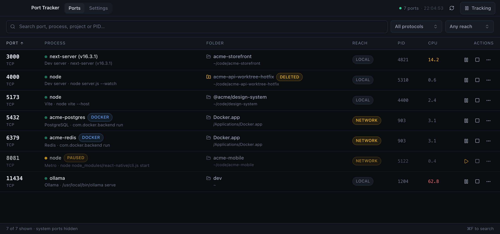
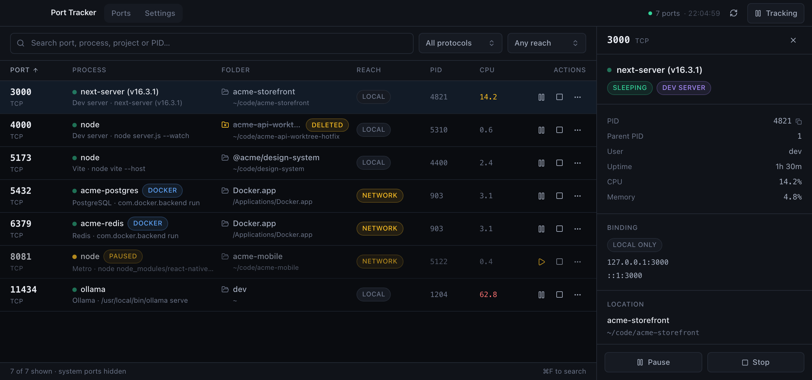
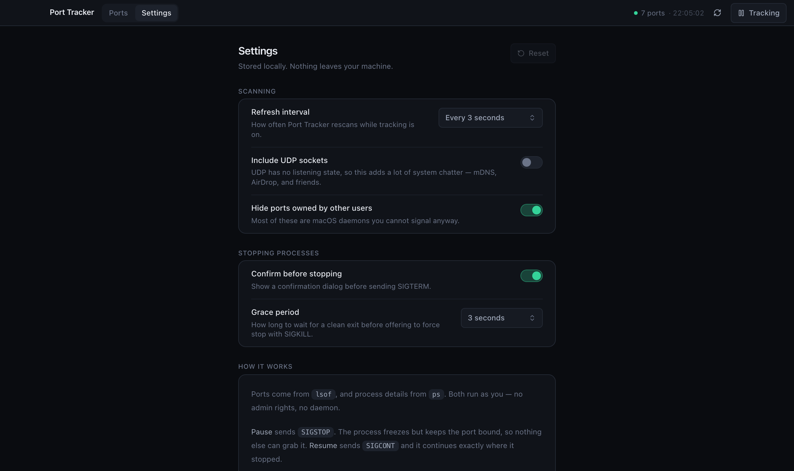

<div align="center">


# Port Tracker

**See every port on your Mac, what owns it, and where it lives.**

A desktop app that lists every listening port, identifies the process behind it,
links straight to that project's folder, and lets you pause or stop it.

Tauri v2 · Rust · React 19 · TanStack Router · Tailwind v4 · Base UI

</div>



## Why

`lsof -i :3000` tells you a PID. It doesn't tell you *which project* that is.

If you run several dev servers, a few worktrees and some containers, the answer
to "what's on 5173 and can I kill it?" takes three commands and a guess. Port
Tracker answers it in one glance — and the folder name is the answer, not the PID.

## What it does

- **Every listening port, live.** TCP by default, UDP opt-in, rescanned on an
  interval you choose. IPv4 and IPv6 bindings for the same port collapse into one row.
- **Identifies the owner.** Process name, full command line, PID, user, CPU, memory
  and uptime.
- **Links to the folder.** Walks up from the process's working directory to find the
  project root — `package.json`, `Cargo.toml`, `go.mod`, `.git` and ten more markers —
  and reads the real package name. Reveal in Finder, open in Terminal, or open in your editor.
- **Flags dead folders.** A dev server from a deleted worktree keeps its port. Those
  rows are marked, because there is nothing left to open.
- **Names containers.** Docker-published ports show the container and image instead of
  the opaque `com.docker.backend` process.
- **Shows reach.** Whether a port is loopback-only or exposed to your whole network.
- **Pause, resume, stop.** Detailed below.

## Pause vs. stop

This is the part worth understanding, because "pause" is not a UI state — it is a
real signal to a real process.

| Action | Signal | Effect |
| --- | --- | --- |
| **Pause** | `SIGSTOP` | Freezes the process. It stops doing work but **keeps the port bound**, so nothing else can claim it. |
| **Resume** | `SIGCONT` | Continues from exactly where it stopped. |
| **Stop** | `SIGTERM` | Asks it to shut down and release the port. |
| **Force stop** | `SIGKILL` | Only after `SIGTERM` is ignored, and only as a separate, explicit click. |

Pausing is the useful one: a Next.js dev server you aren't looking at still burns CPU
and watches the filesystem. Freeze it, keep the port, thaw it when you come back.



## Safety

Signalling other people's processes is easy to get wrong, so the rules are strict:

- PID 1 and below, and Port Tracker itself, are never signalled.
- Critical macOS processes are protected by name — `launchd`, `WindowServer`,
  `loginwindow`, `Finder`, `coreaudiod` and others.
- Processes owned by another user are read-only. macOS would reject the signal
  anyway, so the controls are disabled rather than left to fail.
- Every signal re-checks that the PID still refers to the process you selected, so a
  recycled PID cannot be hit by mistake.
- `SIGKILL` is never sent automatically.
- Losing the race — the process exits on its own between the check and the signal —
  is reported as success, not as an error.

## Running it

```bash
pnpm install
pnpm app
```

`pnpm app` runs `tauri dev`, which starts Vite and the Rust app together.

> `pnpm dev` alone only serves the web UI. It has no backend, so it cannot read
> ports — the app will tell you so if you try.

To produce a `.app` and `.dmg`:

```bash
pnpm app:build
```

### Requirements

- macOS — the scanner shells out to `lsof`, `ps` and `open`
- Node 20+ and pnpm
- Rust stable — `curl --proto '=https' --tlsv1.2 -sSf https://sh.rustup.rs | sh`

No admin rights, no background daemon, no network access. Everything runs as you,
on demand, and nothing leaves the machine.

## How the scan works

Six processes per scan, run in parallel, each with a hard timeout so a stale network
mount can't hang the window.

| Step | Command |
| --- | --- |
| Listening sockets | `lsof -nP -w -iTCP -sTCP:LISTEN -F pftPn` |
| UDP sockets (opt-in) | `lsof -nP -w -iUDP -F pftPn` |
| Process stats | `ps -axo pid=,ppid=,state=,user=,%cpu=,%mem=,etime=` |
| Executable path | `ps -axo pid=,comm=` |
| Command line | `ps -axo pid=,command=` |
| Working directory | `lsof -a -w -p <pids> -d cwd -F pn` |
| Containers | `docker ps` — only when a Docker process is actually present |

`comm` and `command` need separate `ps` calls because both can contain spaces, so
each has to be the last column of its own invocation.



## Tests

```bash
cd src-tauri && cargo test
```

Unit tests cover the `lsof` field parser, `ps` elapsed-time and column splitting,
process-state mapping, `.app` bundle detection and project-root walking against fixed
samples. Two integration tests run a real scan of the host machine and assert the
whole pipeline holds — including that `cwd_exists` matches the filesystem.

## Layout

```
src/
  routes/          TanStack Router file routes (__root, index, settings)
  components/      Table, detail panel, actions provider, Base UI wrappers
  lib/             Tauri bindings, filtering/sorting, formatting, app store
src-tauri/src/
  lib.rs           Tauri command surface
  ports.rs         lsof parsing, grouping, Docker enrichment
  proc.rs          ps snapshot, cwd resolution, project-root detection
  control.rs       Signals, and the Finder/Terminal/editor jump-offs
  sh.rs            Subprocess runner with timeouts
docs/icon.svg      Icon artwork, with regeneration instructions
```

## Notes

Screenshots use a representative dataset rather than a real machine, so that no
project paths end up in version control.

## License

MIT
